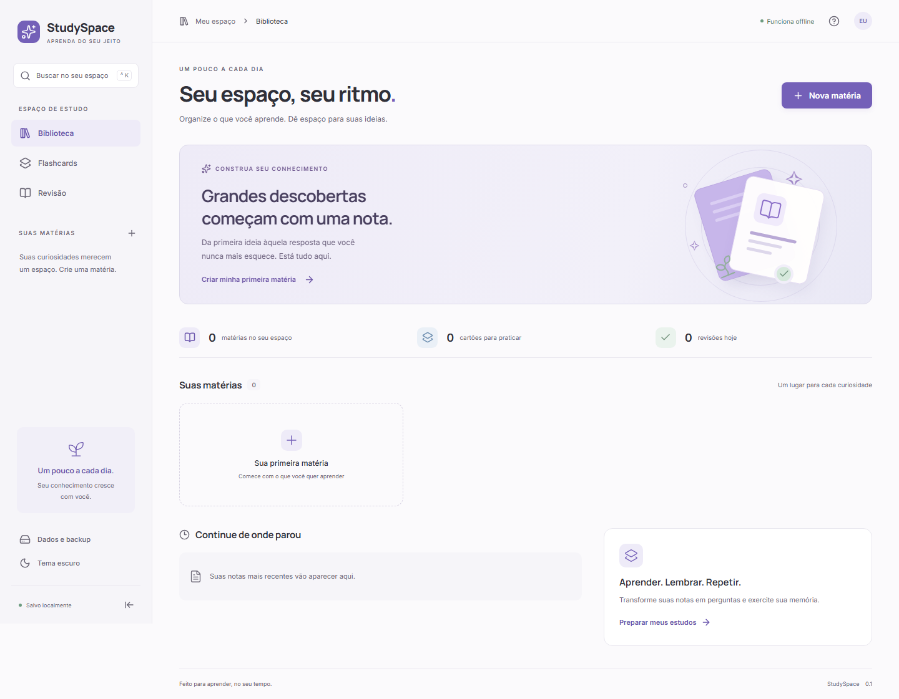

# Study Space

Aplicativo de estudos que roda no próprio computador. Organize matérias, escreva notas e pratique com flashcards, com um assistente de IA opcional.



## Recursos

- Matérias, notas com editor de texto e flashcards vinculados ao material.
- Revisão, busca, importação de CSV, JSON, PDF, DOCX e APKG e backup da biblioteca.
- Dados locais: SQLite WebAssembly e IndexedDB na versão de navegador.
- JARVIS com 15 opções de provedor: Gemini, OpenAI, Groq, xAI, NVIDIA NIM, Anthropic, DeepSeek, Mistral, OpenRouter, Together AI, Fireworks AI, Cerebras, Ollama, LM Studio e API compatível personalizada.
- Listas de modelos carregadas automaticamente para os provedores configurados.
- Leitura com voz instalada no Windows e botão para gravação do microfone.

O estudo funciona sem uma conta de IA. Chamadas de IA e transcrição do microfone usam o provedor configurado; a leitura em voz usa o Windows. Ollama e LM Studio dependem de um servidor e de um modelo instalados separadamente.

## Usar no Windows

Na versão portátil, extraia **todo** o arquivo `StudySpace-Local-0.2.0.zip` e execute **Abrir StudySpace.cmd**. O pacote inclui o runtime Node.js necessário e abre o navegador em:

**http://127.0.0.1:1420/**

O servidor escuta apenas no próprio computador. Use **Encerrar StudySpace.cmd** para encerrá-lo.

## Executar a partir do código

Requer Windows, Node.js 24.12 ou superior e npm. Na pasta do projeto:

```powershell
npm.cmd ci
npm.cmd run local:build
npm.cmd start
```

`local:build` compila a interface, prepara a pasta `app/`, atualiza os adaptadores locais e cria `config/.env` a partir do exemplo, preservando uma configuração existente. O iniciador também usa o Node.js do sistema quando não há um runtime portátil.

Para encerrar:

```powershell
npm.cmd stop
```

Se outra cópia do StudySpace já estiver aberta, encerre-a antes de testar uma nova compilação: a porta 1420 e a origem dos dados são compartilhadas.

Para editar apenas a interface com recarregamento automático, use `npm.cmd run dev`. Para exercitar também as APIs locais do JARVIS, use o fluxo `local:build` e `start`.

## Configurar IA e voz

Edite `config/.env` ou abra **config/Editar configuracao.cmd**. Preencha apenas as chaves que quiser utilizar:

```dotenv
AI_PROVIDER=groq
GROQ_API_KEY=
NVIDIA_API_KEY=
OPENAI_API_KEY=
LOCAL_VOICE_ENABLED=true
```

Abra o JARVIS, entre nas configurações e escolha o provedor e o modelo nas listas. A configuração de voz deve indicar uma voz instalada no seu Windows.

Veja [o guia completo](config/COMO-CONFIGURAR.txt) e [as referências dos provedores](config/PROVEDORES.md).

O `.env` fica no computador, é ignorado pelo Git e não é servido ao navegador. O repositório contém somente `.env.example`, com chaves vazias. Nunca use o prefixo `VITE_` para guardar chaves de API.

## Dados e backup

Na versão local de navegador, os dados pertencem ao perfil e à origem `http://127.0.0.1:1420`. Limpar os dados do navegador remove essa biblioteca. Exporte um backup no aplicativo para guardar ou transferir seus estudos.

## Verificação

```powershell
npm.cmd test
npm.cmd run build
npm.cmd run test:e2e:install
npm.cmd run test:e2e
```

Os navegadores de teste são opcionais para o desenvolvimento e ficam em `.cache/playwright`. Não são necessários para usar o aplicativo.

A entrega local 0.2.0 foi verificada com 72 testes internos e 20 cenários de uso. As integrações de IA foram exercitadas com provedores simulados, sem validar contas reais. Veja [os resultados e limites dessa entrega](docs/VERIFICACAO-LOCAL-0.2.0.txt).

## Estrutura

```text
src/             Interface React e TypeScript
db/              Migrações SQL compartilhadas
runtime/         Servidor local, provedores e voz Windows
config/          Configuração de exemplo e guias
scripts/local/   Preparação da versão local a partir do build
tests/           Cenários de interface e arquivos de teste
src-tauri/       Backend nativo Tauri preservado
docs/            Referências, capturas e guias
```

O backend Tauri e seu fluxo de build continuam no código para desenvolvimento nativo. A distribuição local descrita acima usa o servidor Node.js e o navegador. Dependências de terceiros têm suas licenças em [COMPONENTES-LICENSES.txt](runtime/COMPONENTES-LICENSES.txt) e [NODE-LICENSE.txt](runtime/NODE-LICENSE.txt).
