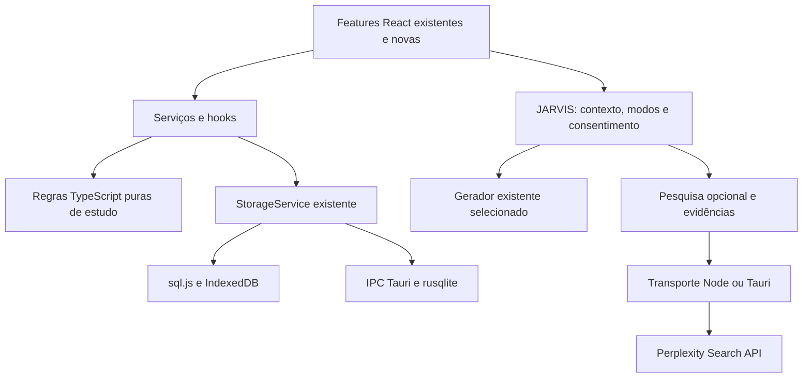

# Arquitetura incremental proposta

Este documento registra o planejamento original e as decisões para as próximas missões. O [backup escalável da Missão 2](MISSAO-2-RESULTADO.md) e a [proteção pré-migração da Missão 3](MISSAO-3-RESULTADO.md) já materializam a evolução de cópias e recuperação, sem mudar o schema local. A regra principal é manter o estudo completo sem IA: organização, materiais, prática, diagnóstico, planejamento e relatórios usam dados e algoritmos locais. IA melhora explicações e pesquisa quando configurada.

## Núcleo compartilhado e plataformas

Implementado nas [Missões 9B/9C](MISSOES-9B-9C-RESULTADO.md), versão 2.0.0: seletores indexados de progresso por matéria, sem persistir indicadores derivados, e gerador local de roteiros de prova/redação como notas comuns. Interface carrega os módulos sob demanda. O planner encaminha simulados pendentes com limite de tempo; criar a nota não conclui o bloco. Importação transacional e backup das notas existentes preservam esses roteiros, sem migração nova. Respostas e resultados permanecem manuais; evidência de diagnóstico e SRS continuam separadas.

Implementado na [Missão 9A](MISSAO-9A-RESULTADO.md): `src/domain/error-notebook` valida registros, captura fontes e aplica revisão otimista; `src/features/error-notebook` oferece lista, edição e prática. Schema 6 acrescenta `error_entries(id,subject_id,data_json)` com proteção pré-migração. Backup com registros exige v7. Fonte e matéria são imutáveis; correção e resolução são explícitas. O atalho após Errei abre um rascunho, e a retomada do cartão usa prática livre. O caderno não infere domínio, não altera SRS ou planner e não envia dados ao JARVIS. A [9B](MISSAO-9B.md) utiliza seletores sobre as entidades existentes.

Implementado na [Missão 8B](MISSAO-8B-RESULTADO.md): fila pura em `src/domain/spaced-repetition/queue.ts`, sessão no `Review` existente, cota global entre matérias conferida na transação com a janela civil do cliente e fluxo explícito de recarga quando a resposta já foi salva. Entrada pelo planner orienta matéria/tempo sem concluir blocos. Não modifica schema 5 ou portátil v6. O limite de novos é preferência local da interface, não uma entidade adicional no backup.

Implementado na [Missão 8A](MISSAO-8A-RESULTADO.md): `src/domain/spaced-repetition` calcula vencimentos determinísticos com regras v1; `src-tauri/src/review_schedule.rs` replica o contrato com vetores compartilhados. Schema 5 acrescenta estado por cartão em `review_schedules`, vinculado à última avaliação. `recordReview` atualiza log e estado atomicamente somente com `schedule:true`. Históricos antigos e prática livre não criam agenda. Backup com estados usa v6. Fila visual, limites diários e entrada pelo planner são completados pela 8B descrita acima.

Implementado nas [Missões 6 e 7](MISSOES-6-7-RESULTADO.md): `src/domain/planner` distribui uma semana com orçamento, pausas, pré-requisitos e fila sem horário; `src/features/planner` oferece prévia, aceite, histórico e Hoje. Schema 4 acrescenta `study_planners(track_id,data_json)` com revisão otimista; agenda exige backup v5. Conclusões e blocos fixos são preservados, e o desfazer guarda somente a última proposta. Planejamento e capacidade são por trilha, sem agregação automática entre elas.

Implementado nas [Missões 4 e 5](MISSOES-4-5-RESULTADO.md): `src/domain/study` reúne catálogo, validação e motor pedagógico puro; `src/features/study` apresenta configuração, materiais e diagnóstico. Schema 3 acrescenta `study_tracks(id,data_json)`, agregado validado com revisão otimista e catálogo imutável por trilha. Biblioteca com trilhas usa backup portátil v4; formatos anteriores continuam legíveis. O restante deste documento mantém a visão de evolução e distingue capacidades futuras.

As regras puras recebem dados, relógio e configurações como argumentos; não conhecem React, rede ou IPC. `StorageService` continua a porta de dados; os serviços/hooks carregam os dados, chamam as regras e persistem o resultado.

Novas pastas somente quando a missão precisar: `src/domain/tracks`, `planner` e `learning` para regras pequenas; `src/features/` para telas; `src/services/research/` para consulta/cache/evidências. Não mover módulos existentes nem criar uma camada abstrata para cada função. O mesmo TypeScript de pedagogia atende web, runtime local e Tauri; SQL novo continua compartilhado em `db/migrations/`.

| Capacidade | Navegador com runtime Node atual | Tauri atual | PWA futura |
|---|---|---|---|
| Biblioteca e núcleo pedagógico | SQLite WASM/IndexedDB; novas regras locais | SQLite nativo; mesmas regras | Mesmo núcleo local, assets preparados offline |
| Geração IA | 15 provedores existentes | Gemini nativo | Opcional por intermediário seguro; estudo independente |
| Voz | TTS Windows e transcrição remota opcional | Voz nativa e transcrição Gemini | Texto sempre; voz conforme capacidade disponível |
| Pesquisa proposta | Rota restrita no processo Node existente | Adaptador HTTPS nativo e cofre | Sem chave persistida no cliente; intermediário opcional posterior |

Não embutir Node dentro do Tauri agora. Primeiro definir as capacidades e fixtures de comportamento; depois ampliar paridade por incrementos. PWA não elimina o iniciador local. Origem, identificador nativo e dados existentes permanecem estáveis; migração entre bibliotecas requer exportar/restaurar explicitamente.

## Trilhas como conteúdo configurável

Separar **catálogo pedagógico** de **progresso pessoal**. Pacotes contêm unidades, competências, relações de pré-requisito e atividades; trilhas aplicam um objetivo e configurações a esse catálogo. Uma matéria existente do estudante continua sendo a mesma entidade, relacionada às unidades por IDs; notas/cartões/documentos não são duplicados.

Manifesto de pacote: ID estável, versão, autor/origem, licença, data de revisão e versão mínima do formato. Unidade: ID, matéria, competências, duração estimada, recursos e pré-requisitos. Validar IDs e grafo acíclico, referências ausentes e distinção entre dependência necessária e recomendação. Não criar um grafo nacional completo antes de validar uma pequena fatia pedagógica.

| Predefinição | Comportamento proposto |
|---|---|
| ENEM — Do zero | Ano escolar de partida selecionável, revisão de pré-requisitos e avanço por evidência. Prova semanal curta reservada no orçamento; simulado maior conforme tempo disponível. |
| ENEM — Intensivo | Data-alvo, importância dos assuntos com fonte editorial datada, dificuldades individuais, redações e simulados. Não inventar frequência de cobrança nem prometer previsão de nota. |
| Ensino médio | 1º, 2º e 3º ano, matérias, bimestres e avaliações editáveis conforme escola/calendário. Série não marca conteúdo como dominado. |
| Vestibular/concurso | Importação assistida de tópicos de edital, pesos e datas informados/verificados; prévia editável. Não depender de extração perfeita por IA. |
| Personalizado | Criar, ordenar e relacionar unidades, configurar ritmo e exportar pacote de conteúdo sem registros pessoais. |

Todos usam o mesmo motor. Os catálogos de produção exigem revisão pedagógica, referências oficiais e direitos de uso de questões. Uma estrutura com poucos tópicos demonstrativos não deve ser anunciada como currículo completo. Começar pelo vertical ENEM Do zero e disponibilizar os demais perfis em incrementos.

## Diagnóstico e evidências

Configuração da trilha: objetivo, ano escolar inicial informativo, data da prova opcional, disponibilidade por dia, matérias, dificuldades autodeclaradas, frequência de revisão/provas, intensidade, tamanho preferido de bloco e ritmo. Não exigir data de nascimento ou dados de escola para planejar.

O diagnóstico é opcional, retomável e curto. Respostas, acertos, tipo de questão, competência, data e origem formam evidências; autoavaliação tem peso distinto. Ausência de tentativa é **desconhecido**. Lacunas sugerem retomada de pré-requisitos; permitir ao estudante ajustar ou testar a recomendação.

Domínio estimado deve mostrar amostra, recência e incerteza. Uma única resposta ou cartão repetido não prova domínio de toda a competência. Usar regra transparente por competência, versionada e testável; começar com faixas de evidência, sem modelos estatísticos ou personalização de algoritmo por estudante.

## Planner local adaptativo

Entrada: configuração, unidades elegíveis, evidências recentes, revisões devidas e atividades fixadas. Saída: proposta de blocos com motivo, duração, vínculos e versão do plano. O estudante pode aceitar, editar ou manter a agenda manual.

1. Calcular minutos realmente disponíveis até a data-alvo, excluindo dias livres e blocos fixos. Reservar inicialmente 20% como margem configurável de recuperação; não usar a intensidade para superar o teto declarado.
2. Determinar unidades elegíveis por pré-requisitos. Sem diagnóstico, começar com verificação/revisão conservadora, sem presumir domínio pelo ano escolar.
3. Ordenar candidatos por prazo, revisão vencida, lacuna, peso do objetivo e tempo desde o último contato. Pesos são política versionada; empates usam ordem estável. Limitar concentração numa matéria e tamanho dos blocos.
4. Distribuir revisão, aprendizagem, prática, redação e avaliação dentro do orçamento. Uma mesma revisão tem um único ID e não ocupa slots duplicados. Simulados/provas consomem minutos reais; não são carga adicional invisível.
5. Se a carga não couber, apresentar déficit e escolhas: reduzir escopo, ajustar disponibilidade ou data. Não comprimir atividades artificialmente nem acumular todos os atrasos amanhã.
6. Replanejar pendências mantendo concluídos e blocos fixados. Distinguir adiar de reprovar. Limitar replanejamento ao horizonte afetado, guardar motivo e permitir desfazer a última proposta.

Ajustes de desempenho alteram seleção de conteúdo, prática e revisões com limites de mudança; não elevam carga máxima. Provas semanais avaliam amostras do conteúdo estudado e lacunas relevantes. Caso a disponibilidade não comporte a frequência solicitada, negociar isso na prévia.

Eventos usam UTC; dia de estudo e data da prova usam calendário local e fuso configurado do estudante. Injetar relógio nos testes para atrasos, virada de dia, mudança de fuso, prazo passado, disponibilidade zero e plano impossível. Mesma entrada e versão geram o mesmo plano.

## Aprendizagem, revisão e caderno de erros

Preservar `review_logs` e a prática livre. Acrescentar tabela de estado por cartão apenas na missão SRS: vencimento, intervalo, facilidade/estado mínimo e `algorithmVersion`. Primeira política proposta: SM-2 simplificado e documentado, mapeando explicitamente as quatro avaliações e separando reaprendizagem. FSRS pode ser avaliado depois por comparação, sem trocar algoritmo silenciosamente.

Não reinterpretar avaliações históricas como agenda confiável. Cartões antigos iniciam uma fila controlada de introdução/calibração; preservar histórico e evitar vencer toda a biblioteca de uma vez. Prática livre continua separada da revisão agendada, com regra explícita sobre quando atualizar o estado. Registro da avaliação e próximo vencimento devem ser atômicos e idempotentes.

Caderno de erros referencia tentativa, questão/unidade, nota ou cartão; registra tipo de dificuldade, correção revisada e próxima ação. Reusar NoteEditor, leitor e CardModal. Relatórios por matéria/competência distinguem tempo/atividade, desempenho e evidência de domínio. Redação usa editor e rubrica manual; IA fornece feedback opcional, sem nota oficial presumida.

## JARVIS 2.0 e pesquisa

Manter cliente, contexto, ferramentas, consentimento e voz existentes. Modos iniciais: explicar, perguntar guiando, praticar e revisar erros, expressos como políticas leves de sessão. Contexto de trilha pode incluir objetivo e atividade atual somente quando autorizado; agendamento não depende do modelo. Sugestões de cartões, plano e notas continuam propostas com prévia.

Pesquisa e geração são controles independentes. `ResearchRequest` leva consulta e filtros mínimos; `ResearchResult` retorna status, fontes normalizadas, custos estimados, `retrievedAt` e indicação de cache. Fonte web tem ID, URL, título, trecho, data de publicação/atualização opcionais; fonte local conserva documento/página. Search fornece ID da requisição; se o resultado não tiver ID próprio, atribuir ID local estável somente aos itens realmente recebidos, mantendo a URL e a requisição de origem. Adicionar campo separado para fontes web na primeira missão, preservando o contrato atual de `references` locais; só unificar por união discriminada quando houver necessidade comprovada.

Fluxo: estudante solicita pesquisa → transporte seguro consulta Perplexity → resultados validados → fontes disponíveis na interface → gerador atual fundamenta explicação quando configurado. Sem gerador, mostrar lista de resultados. Sem pesquisa, responder como explicação geral, quando houver gerador, com estado explícito. Nenhuma referência é construída a partir de links inventados pelo modelo. Detalhes oficiais e contingências em [PERPLEXITY.md](PERPLEXITY.md).

## Dados, recuperação, privacidade e pacotes

Adicionar entidades somente na missão que as utiliza: pacote/unidade, trilha/configuração, tentativa/evidência, plano/bloco, revisão agendada e erro. Cada incremento inclui SQL compartilhado, validadores TS/Rust, adapters e backup/restauração. Versão do banco, do backup e do pacote são contratos diferentes. Leitores novos mantêm v1/v2; leitores antigos recusam versões novas sem escrever. Não aumentar apenas o número de versão do app e chamar isso de migração.

Backup escalável proposto: envelope versionado com manifesto, dados e materiais separados em arquivo compactado, reutilizando `fflate` e validações existentes. Desenho exato e limites expandidos serão confirmados na Missão 2 com medição de memória; compressão sozinha não resolve o custo de materializar tudo em RAM. Não chamar o formato de v3 até fechar seu contrato. Leitor v1/v2 permanece, sem truncamento silencioso.

Antes de migração, guardar cópia consistente validada. Desktop usa mecanismo SQLite compatível com WAL; browser guarda bytes anteriores sob a exclusão já existente, antes de publicar o banco migrado. Proposta inicial de retenção: três gerações, limitada por espaço e com opção de exportar; falha de quota impede migrar e orienta recuperação. Cópia interna não substitui backup externo. Nunca testar restauração sobrescrevendo biblioteca pessoal; restaurar em destino vazio/isolado.

Credenciais ficam fora do domínio pedagógico e backups. Node preserva `.env` existente como compatibilidade e informa seu caráter local em texto; oferecer armazenamento protegido do sistema por adaptador quando disponível, sem criptografia caseira ou fallback silencioso. Tauri estende o cofre por capacidade/conta, preservando a credencial Gemini atual. PWA inicial entrega o núcleo de estudos; pesquisa remota só com transporte intermediário seguro opcional, escopo próprio e consentimento. Não criar backend obrigatório nem embutir chave compartilhada.

Pacote compartilhável é conteúdo, separado do backup pessoal. Por padrão exclui diagnóstico, desempenho, horários, conversas, notas privadas e credenciais. Reusar prévia/importação transacional, validar licença, hashes, tamanho compactado/expandido e relações; rejeitar scripts e conteúdo executável. Atualização de pacote cria nova versão, preserva referências e só remapeia progresso com prévia explícita. Autoria de professor pode começar por esses pacotes; contas de turma e dados de menores exigem desenho próprio posterior.

## HUD, acessibilidade, PWA e desempenho

Acrescentar à Library um bloco “Hoje”: carga prevista, revisões devidas, próxima atividade e reagendamentos explicados. Manter biblioteca e busca próximas; não trocar toda a navegação. Reusar tokens, Modal, Button, ErrorMessage e estilos existentes. Melhorar linguagem, fonte e alvos de toque conforme cada fluxo; oferecer menor movimento, teclado completo, leitura por tecnologia assistiva e estados claros. Meta de validação: WCAG 2.2 AA, incluindo checagens manuais; não declarar conformidade só por Axe.

PWA: manifesto, cache versionado de assets locais (inclusive WASM, worker PDF, fontes e módulos lazy), abertura/reload offline após preparo completo, aviso de atualização e coordenação com schema. Não ativar atualização enquanto houver edição pendente ou misturar código antigo com banco novo entre abas. Cache HTTP não guarda chave nem chamadas de IA por padrão; limpar cache de assets não pode apagar IndexedDB. Instalação offline inicial depende de distribuição/pré-carga apropriada; um primeiro acesso pela web requer conexão.

Medir antes de otimizar: tempo de abertura, salvamento, geração de plano e memória com bibliotecas sintéticas pequenas/grandes. Seletores indexados, consultas limitadas e paginação têm precedência sobre virtualização ou workers; deslocar CPU pesada para worker apenas após medir bloqueio. Manter importação, PDF e IA fora do caminho crítico de abrir e estudar.
